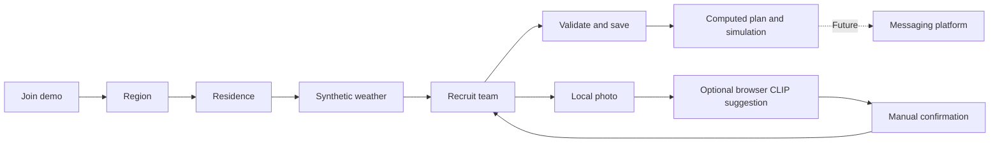

# Housemates guided demo

Entry: **Join the demo** on `/`, or `/demo`. The existing `/household` and `/energy-parliament` remain separate, working experiences. Setup never replaces an existing household plan.

## User pipeline

1. **Region.** Choose a public city preset: San Francisco, London, Bangkok, Tokyo, Oslo or Sydney. The island, paths and regional planting fall into place. Each preset selects original procedural scenery and declared synthetic electricity/carbon factors. These are examples, not reconstructed geography, real tariffs or national averages.
2. **Residence.** Choose apartment, townhouse or detached home. The building and roof drop onto the island. Residence selects a disclosed illustrative background-demand coefficient, not a calibrated thermal model.
3. **Weather.** Inspect an authored 24-hour synthetic temperature/humidity card. Adjust temperature by −10…+10°C and choose clear/cloud/rain/snow scenery. Temperature/humidity affect illustrative background heating/cooling; visual weather codes do not invent energy effects. No live-weather or geolocation call is made by the demo.
4. **Team.** Toggle Evie, Bubbles and Chill, or open local photo setup. Every addition lands in the world. A photo can receive an optional on-device model suggestion, followed by explicit manual type selection and confirmation. Photos never determine power, deadlines, brand/model, or device connectivity.
5. **Move in.** Save a validated setup locally, display a selected-team cost/carbon/balanced plan using the existing deterministic engine, and scrub the simulation clock. Resume restores region, residence, team and weather choices. Empty restored teams return to recruitment. Messaging integration remains a future chapter.

Pip is an original procedural 3D guide with scripted contextual guidance. Its text is not an LLM response. Scene construction supports Finish build, Replay build, front-facing rotation, zoom and reduced motion. On phones Pip remains sticky while scrolling through the setup controls.

## Photo recognition design

Transformers.js loads a pinned quantized CLIP model in a Web Worker only after the user requests a suggestion. The first use downloads approximately 190 MB of model/runtime/tokenizer assets; browser caching may reduce later downloads. A worker receives the local photo, decodes it and compares supported appliance descriptions against negative candidates such as other appliances and unrelated scenes. It sends relative candidate scores back to the UI. Scores are not calibrated confidence or verified identification.

The interpreter abstains on unsupported, weak, ambiguous or malformed results. A successful suggestion still requires the user to choose an appliance type and press Confirm housemate. Manual selection remains available for unsupported browsers, canceled downloads, model/network errors or poor photographs. Cancellation terminates the worker; replacing/removing a photo and unmounting invalidate stale results and release object URLs. No image is sent to a recognition service, no API key is needed, and no MCP connection is required.

References: [Transformers.js pipelines](https://huggingface.co/docs/transformers.js/api/pipelines), [official Next.js integration](https://huggingface.co/docs/transformers.js/tutorials/next), [CLIP ONNX model](https://huggingface.co/Xenova/clip-vit-base-patch32). See implementation constants for the pinned model revision and package lock for the runtime version.

## Calculation and persistence boundaries

`src/domain/demo.ts` validates profile fields, derives regional synthetic prices/carbon from the existing 24-hour dataset, and invokes the existing optimizer with only selected Evie/Bubbles requests. The background heating/cooling estimate stays separate from appliance costs, baselines and savings. Chill is never optimized or controlled. All displayed money uses USD comparison units; regional factors are not currency conversions.

`housemates-demo-v1` stores only bounded, validated setup fields. It never stores photos, recognition scores, weather downloads or unvalidated calculated outputs. The UI recomputes plans after restoration. Blocked browser storage yields a session-only message. The existing household memory key is untouched. A dormant, tested public-weather adapter remains in `demo-weather.ts` for potential future work; the current UI neither imports nor calls it.

## Agent workflow and release gate

- Lead owns onboarding UI, route, state transitions, persistence wiring, homepage entry, integration and final release.
- Scene engineer owns only the existing renderer and its stylesheet; extends rather than duplicates it.
- Data engineer owns demo presets, pure scenario/weather helpers and boundary/calculation tests.
- Guide/capture engineer owns mascot, capture, local inference worker and recognition interpretation tests.
- A different specialist reviews each implementation. Visual reviewers must view actual desktop/mobile screenshots and construction frames.

Every lane follows implement → scoped checks → inspect failure → repair → recheck → independent review. The lead runs the real browser journey, captures repaired layouts, checks legacy routes, then runs lint, TypeScript, tests and a production build. Only a passing milestone is committed locally. No remote deployment, external messaging or paid API calls are part of this milestone.
