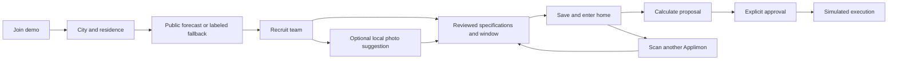

# Housemates guided demo

Entry: **Join the demo** on `/`, or `/demo`. The landing page is a simple scroll-driven world and phone story. Detailed controls and calculated numbers live in the demo. The existing `/household` and `/energy-parliament` remain separate; demo setup never replaces their memory.

## User pipeline

1. **Region.** Choose San Francisco, London, Bangkok, Tokyo, Oslo or Sydney. The island, paths, planting and an original symbolic landmark fall into place. City factors define authored USD price/carbon scenarios, not actual tariffs, currency conversions or national averages.
2. **Residence.** Choose apartment, townhouse or detached home. The building and roof drop onto the island. Residence sets an illustrative background-demand coefficient, not a calibrated thermal model.
3. **Forecast.** Load current conditions and two local calendar days from Open-Meteo, or select Synthetic what-if. The card identifies source, time and city timezone. Provider failures, invalid or stale responses produce a labeled synthetic fallback. Synthetic controls allow −10…+10°C and clear/cloud/rain/snow scenery. Public forecast temperature and humidity inform illustrative heating/cooling; neither mode measures indoor conditions.
4. **Team.** Recruit any of ten categories. The original three can use their authored quick-start settings; Review specs opens their editable passport. Additional categories require specification review. Photo setup offers an optional local category suggestion, then opens the same spec review. Category selection alone never recruits through that photo path. Explicitly confirm electrical rating, task energy/duration, baseline and scheduling window. Use illustrative defaults only through the labeled action.
5. **Move in.** **Finish build & enter home**, the final scene action and Pip's advance callback share completion. Save validated setup in this browser and open `/demo/home`. Skip animation is a separate visual action. A blocked write keeps the finished home usable in this session with a truthful notice. Direct home visits restore a valid team or return to setup.
6. **Recruit later.** **Scan an Applimon** opens `/demo/scan`. Camera/file selection and manual categories converge on reviewed specifications. Confirmation merges into the latest saved world, updates its models and offers a return home. Existing categories are updated rather than duplicated. Without a saved world, review is available but recruitment cannot claim persistence.

Pip is an original procedural 3D mascot with written contextual dialogue, explicit navigation and optional help. The current setup places its tutorial in the game-style dialogue dock; it does not autonomously advance or mutate planning inputs. Construction uses the existing Three.js lifecycle, native scrolling, front-facing rotation, zoom, animation skip and reduced-motion alternatives.

## Ten categories and safety policies

| Character | Category | Policy |
| --- | --- | --- |
| Evie | EV charger | Flexible uninterrupted charge |
| Bubbles | Dishwasher | Flexible uninterrupted cycle |
| Chill | Air conditioner | Protected; illustrative cooling trace only |
| Spin | Washer | Flexible cycle |
| Tumble | Dryer | Flexible cycle |
| Ember | Water heater | Protected; no temperature/heating scheduling |
| Misty | Dehumidifier | Optional user-defined timed task, no humidity guarantee |
| Rover | Robot vacuum | Flexible modeled task |
| Frost | Refrigerator | Protected; no cooling scheduling |
| Breeze | Fan | Fixed routine |

The MVP supports one device per category. Photos map to original category sprites and low-poly models, not custom reconstructed 3D assets. No identity, connectivity, electrical consumption or safe operating policy is inferred from appearance. Protected categories never enter time-shifting savings. Breeze's unchanged baseline is separate from flexible savings. Washer/dryer ordering and shared circuit limits are not invented.

## Photo and nameplate paths

Category recognition and electrical specification review are different steps. Optional CLIP inference runs in a worker after an explicit action; first use downloads approximately 190 MB. The expanded mode compares ten supported categories and nine negative descriptions. Scores are relative matches, not calibrated probabilities. Abstention, cancellation and manual selection remain available.

The passport form can read a local nameplate photo using Tesseract.js 7 after **Read label on this device**. First use downloads OCR worker/core/language assets. OCR returns draft text and candidate buttons; it never fills trusted settings or recruits automatically. Enter or select explicit W/kW electrical input and per-task kWh, then review all fields. The parser abstains on ambiguous annual, per-100-cycle, weight-normalized and thermal/output ratings. It does not derive watts from volts × amps. Duration and availability remain user-reviewed. If only rated watts are known, the user must explicitly choose the full-power estimate and its warning.

Photos, raw OCR text and match scores stay out of localStorage and transfer links. Only validated, confirmed passport fields persist. Manual entry works without inference downloads. See [RECOGNITION.md](RECOGNITION.md) for limits, lifecycle and evidence.

## Weather, arithmetic and persistence

`/api/weather` accepts one of six configured city IDs, not arbitrary coordinates or URLs. Its server adapter requests two forecast days from Open-Meteo without geolocation or an API key. It validates units, city/timezone, complete hourly sequences and freshness. Successful responses are cached ten minutes per city; failed-provider fallbacks are cached briefly. The browser stores a validated snapshot with its source and timestamp and refreshes only on applicable city/mode changes or an explicit refresh, rather than silently changing an approved plan. Restored snapshots are snapshots, not a claim of continuously current conditions.

The model uses Day 2 hourly weather when available. The card plots the first local day; the underlying building/AC calculation can use the following day. The planner still has 48 modeled hour slots. Unsupported local-day shapes fall back; no DST-aware scheduling is claimed. A synthetic fallback has an explicitly fictional date and repeats its day.

`demo-grid.ts` supplies authored regional demand/solar/net-demand curves; `demo.ts` combines these with the existing synthetic electricity dataset. California has a pronounced midday solar trough while other fictional regions differ. Price and carbon shapes are distinct so cheap energy need not be cleanest. Mechanism references: [CAISO duck curve](https://www.caiso.com/documents/flexibleresourceshelprenewables_fastfacts.pdf), [EIA net load](https://www.eia.gov/todayinenergy/detail.php?id=56880). Numeric curves are authored and do not come from these sources.

Core Evie/Bubbles passports feed the existing deterministic scheduler. `applimon-planning.ts` prices additional-party jobs with the shared interval arithmetic, validates feasibility, and returns cost/carbon/balanced options with signed baseline comparisons. Exact fractional task duration is supported; starts/windows/deadlines are whole-hour slots. Rating alone is not average consumption: cycle power uses reviewed task energy divided by duration. Core and expanded-party totals remain separate to prevent double counting.

Chill's cooling trace partitions existing background cooling; it is never added twice or included in flexible savings. The weather-driven thermal estimate is illustrative, with no comfort guarantee, thermostat automation or metered savings claim. Rates and carbon stay synthetic even when weather is live.

`housemates-demo-v1` stores bounded validated setup, optional forecast snapshot, planning mode and reviewed passports. Unknown fields are dropped; calculations are recomputed. Existing household memory uses its own key. Additional-party chat revisions, approval and execution are session-only: reloading requires a new approval. Core chat has its separate validated paused-run restoration; see [VOICE.md](VOICE.md). Editing a persisted passport requires another explicit review. No chat transcript, audio, photo or OCR text is added to this profile.

Phone and laptop storage are independent. A category-only link can transfer an untrusted suggestion but never a photo, passport, household or automatic recruitment. Use the laptop's LAN address from a phone on the same network; phone `localhost` is not the laptop. Camera/microphone browser access may require HTTPS; manual entry and file upload remain fallbacks.

## Messaging and local verification

The completed demo has deterministic text commands and optional browser speech for the core team. Additional categories use their party planning panel. Proposed schedules, approved runs, preview clock and execution clock remain distinct. Only the explicit approval control starts simulated work. There is no physical device control.

Optional iMessage transport requires an owner-configured BlueBubbles Mac bridge, dedicated identity and server-only credentials. It currently targets Evie, Bubbles and Chill and keeps approval in the browser. It is **Not connected** without configuration; real message delivery has not been exercised. See [IMESSAGE.md](IMESSAGE.md).

Scene landmarks are original symbolic miniatures: Golden Gate Bridge, Elizabeth Tower, a Grand Palace-inspired pavilion, Tokyo Tower, Oslo Opera House and Sydney Opera House. Placement and scale are imaginary; sources are in `src/data/city-landmarks.ts`.

The self-correcting workflow remains implement → scoped checks → inspect failure → targeted repair → rerun → independent review → integrate. Source/component regressions cover category/spec gates, stale results, profile merges, protected policies and approval. A real OCR engine read a synthetic 2000 W / 0.70 kWh test label; this does not establish real-nameplate accuracy. Physical-phone camera behavior and ten-category recognition accuracy remain unverified. Current full-suite, browser and production-build acceptance belongs in [PROGRESS.md](PROGRESS.md); this document does not assert that an in-progress integrated release has passed. No public deployment is claimed.

### Scanner review update

The team step now places photo recruitment before the catalog. Photo selection/matching is followed by three compact specification cards, then an animated Applimon arrival after explicit confirmation. This is the same reviewed pathway used by `/demo/scan`; arrival alone never starts an energy task. Both dialogs retain keyboard cancellation and local-file cleanup. Actual model evaluation and remaining recognition failures are documented in SCAN-PHOTO-EVALUATION.md and SCAN-EVALUATION.md.
